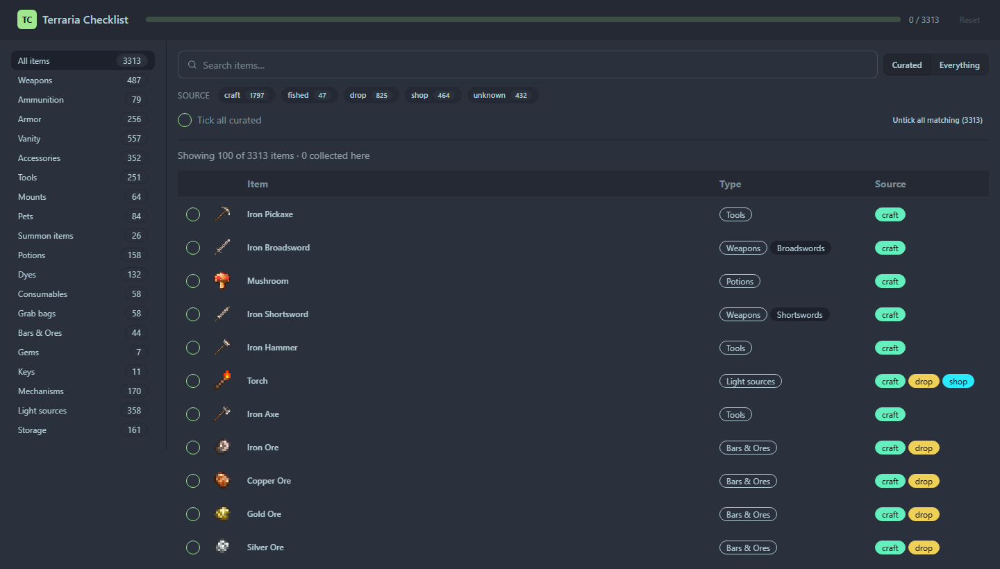
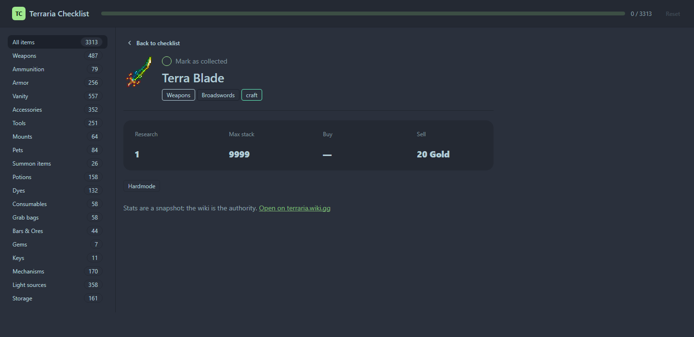

# Terraria Checklist

A checklist web app for tracking which of Terraria's 6,140 items you have collected.

Item data is generated from the [Terraria Wiki](https://terraria.wiki.gg) at build time and
committed to the repository, so the app itself is a **static front end with no backend** and no
runtime dependency on the wiki.





---

## Table of contents

- [Quick start](#quick-start)
- [The decision that shapes everything](#the-decision-that-shapes-everything)
- [Features](#features)
- [Architecture](#architecture)
- [Repository layout](#repository-layout)
- [The data pipeline](#the-data-pipeline)
- [The four data rules](#the-four-data-rules)
- [Data contract](#data-contract)
- [Progress storage](#progress-storage)
- [Styling](#styling)
- [Scripts reference](#scripts-reference)
- [Known limits](#known-limits)
- [Troubleshooting](#troubleshooting)
- [Attribution](#attribution)

---

## Quick start

Requires **Node.js 20.11+** (developed against Node 24).

```bash
git clone <your-repo-url>
cd TerrariaCheckList
npm install
npm start
```

Then open <http://localhost:4200>.

The committed snapshot under `public/data/` means this works offline with no wiki access and no
API keys. You only need network access if you want to *regenerate* the data.

---

## The decision that shapes everything

The obvious design — have the browser fetch the item list from the wiki — **does not work**, and
not for a reason that can be fixed in application code.

The wiki's rate limiter responds:

> `{"error":{"code":"ratelimited","info":"You've exceeded your rate limit. Please make sure you
> are setting a custom user agent with the username of your wiki account."}}`

Browsers are forbidden from setting `User-Agent`, so every runtime fetch is rate-limited from
the first request with no client-side workaround. So the data is fetched once, at build time,
and committed:

```
tools/snapshot/  --gather-->  public/data/  --fetch-->  Angular app
   (Node, dev only)            (committed JSON)          (static, no backend)
```

This also buys:

- **Reproducible offline builds** — a fresh clone builds without touching the wiki.
- **Reviewable data changes** — a wiki update shows up as a diff in a pull request.
- **No third-party runtime dependency** — the site cannot break because the wiki is slow.
- **A failing build instead of bad data** — a truncated fetch fails the integrity gate rather
  than silently shipping a half-empty list.

---

## Features

**Browsing**
- 3,313 curated items by default, with a toggle to all 6,140.
- Sidebar categories with live counts (Weapons 487, Vanity 557, Potions 158, …).
- Two-level navigation where data supports it: 16 weapon kinds (Broadswords, Guns, Yoyos, …).
- Case-insensitive search that narrows before rendering.

**Filtering**
- Source tag chips: `craft`, `fished`, `drop`, `shop`, `unknown`, each with a count.
- Tags are a **set**, not a single value — Torch is `craft` + `drop` + `shop`, and all three show.
- Filters are additive: selecting "craft" and "shop" shows items obtainable by *either*.

**Tracking**
- Per-item checkboxes with a progress bar over the whole active tier.
- Bulk actions: tick all shown, untick all matching, reset everything.
- Progress persists in `localStorage`, keyed on stable item ids.

**Item detail**
- Wiki sprite, category, weapon kind, and source badges.
- **Crafting**: station icons, output count, and ingredients with quantities, each linked to its item.
  Compound stations ("Work Bench and Ecto Mist") render one icon per station.
- **Dropped by**: every enemy or container, with environment and a per-difficulty rate table.
- **Sold by**: vendor and coin price.
- **Difficulty badge** for items that cannot drop on Normal.
- Research cost, stack size, buy/sell price, and raw wiki tags.

---

## Architecture

Angular 22, standalone components, signals, **zoneless** change detection, lazy feature routes.
No `NgModules`, no `zone.js`.

| Path | Role |
|---|---|
| `src/app/core/models.ts` | Types mirroring the snapshot, plus source-mask, coin, and sprite helpers |
| `src/app/core/snapshot-repository.ts` | Loads the five JSON files as `httpResource`s |
| `src/app/core/progress-core.ts` | Pure progress logic: parse, migrate, reconcile with the snapshot |
| `src/app/core/progress-store.ts` | Signal/effect shell over that logic, backed by `localStorage` |
| `src/app/core/checklist-store.ts` | The single place holding filter state and derived counts |
| `src/app/features/checklist/` | Search, tier toggle, source filters, item table, row component |
| `src/app/features/item/` | Item detail, routed at `/item/:id` |

### Design decisions

**Progress is keyed on item id** — never name, never array index. Names drift between wiki
snapshots and array indices shift when the snapshot is regenerated; ids do not. A
`schemaVersion` change is reported rather than silently discarding progress, and ids that no
longer exist in the snapshot are dropped *and counted*, so the total never inflates forever.

**State lives in services, not components.** `ChecklistStore` owns filter state because the
sidebar sets the category, the toolbar sets the search, and both must agree on what "filtered"
means. Components stay presentational, so the logic is testable without rendering.

**Progress decisions are pure functions.** `progress-core.ts` holds parsing, migration and
reconciliation with no Angular imports, so those rules are tested without a `TestBed`,
injection context, or change-detection ticks.

**The list is paginated, not virtualised.** Filters narrow 6,140 items *before* rendering, so a
windowing library would add a dependency to solve a problem the filters already solved.

**Acquisition detail is a separate file.** The list view never renders a recipe, so
`items.sources.json` (the largest payload) is loaded without blocking the list.

---

## Repository layout

```
public/data/          committed wiki snapshot — served at /data/*.json
src/                  the Angular application
src/app/core/         models, data loading, progress, filter state
src/app/features/     checklist and item-detail pages
tools/snapshot/       the wiki data generator (dev only; never shipped)
tests/snapshot/       generator tests (node:test)
docs/screenshots/     README images
.cache/               fetch + npm cache (gitignored, never a source of truth)
```

---

## The data pipeline

```
fetch (cached)  ->  normalize  ->  emit  ->  validate
tools/snapshot/     .cache/snapshot/  public/data/
```

| File | Role |
|---|---|
| `gather.mjs` | CLI orchestration and reporting |
| `wiki-client.mjs` | API client: User-Agent, `maxlag`, throttling, backoff, pagination |
| `fetch.mjs` | Stage 1 — pulls four Cargo tables; disk cache with content hashes |
| `normalize.mjs` | Stage 2 — pure transform, no I/O, no network |
| `schema.mjs` | Categories, source tags, weapon-kind allowlist |
| `schema-difficulty.mjs` | Difficulty masks and the wiki's mode-segmented rate parser |
| `emit.mjs` | Stage 3 — atomic writes into `public/data/` |
| `validate.mjs` | Integrity gate; a non-zero exit fails the build |
| `curation.json` | Hand-edited inclusion rules, never overwritten by the generator |

Normalisation is a pure function of the cached rows, so iterating on category or filter rules
costs **zero** wiki requests (`npm run gather --rebuild`).

### Cargo tables used

| Table | Rows | Provides |
|---|---:|---|
| `Items` | 6,355 | id, name, wiki type/tag, listcat, market and research data |
| `Recipes` | 4,266 | crafting station, ingredients with quantities |
| `Drops` | 3,253 | source, quantity, per-difficulty rate |
| `NPCs` | 770 | enemy display name, id, type, environment |

### Wiki etiquette

Required, not optional:

- a descriptive `User-Agent` with contact details (`SNAPSHOT_CONTACT`)
- `maxlag=5` on every request, so the pipeline yields to editors during replication lag
- one request at a time, 3.5 s apart (verified safe)
- exponential backoff on 429/5xx, never parallel bursts
- `limit` capped at 500 — Cargo silently returns 500 rows for larger values

Set a real contact before fetching, as the wiki asks:

```bash
SNAPSHOT_CONTACT="YourWikiName" npm run gather:refresh
```

---

## The four data rules

These are the parts that fail *silently* if you get them wrong. Each is covered by tests.

### 1. `type` is not a partition

2,442 of 6,355 rows carry multiple `type` values. `Torch` is
`furniture^light source^crafting material`; `Wood` is `block^crafting material`.

Filtering by "has type X" would place one item in three lists and make every count wrong.
`resolveCategory()` intersects type and tag against a **priority-ordered** list and returns
exactly one category, so a torch is a light source rather than furniture.

### 2. Nine item ids are shared by two different items

Legacy mobile/3DS content collides with current content:

| id | legacy | current |
|---|---|---|
| 5036 | Ocram Trophy | Otherworldly Music Box (Lunar Boss) |
| 5048 | Shiny Black Slab | Wandering Jingasa |
| 5076 | Red Envelope | Royal Scepter |
| 5078 | Mythical Lion Mask | Prince Uniform |
| 5079 | Firecracker (mobile) | Prince Pants |

The legacy row always carries `internalname = "None"`, so `pickCanonicalRow()` prefers the row
with a real internal name, then the row not flagged `unobtainable`. Progress keys on `itemid`,
so an unresolved collision would corrupt user progress.

### 3. Obtainability is a set, not a single value

An item is often obtainable several ways, so each carries a **bitmask** of every applicable
route and the UI renders one badge per set bit:

| item | tags |
|---|---|
| Torch | `craft` + `drop` + `shop` |
| Golden Crate | `craft` + `fished` |
| Minishark | `shop` |
| Rod of Discord | `drop` |

**321 items carry more than one route.** An earlier single-value design with a precedence order
discarded that: it reported Torch as `craft` only, hiding that it is purchasable.

There is deliberately **no "primary route"** — the wiki never states one, and ranking craft
above drop above purchase would fabricate information.

### 4. Weapon kinds come from `listcat`, via an allowlist

`listcat` mixes real kinds with behaviours (`projectile melee`), properties (`wall-piercing
weapons`) and acquisition flags (`loot items`, `craftable items`), and ships 27 case variants.
Taking "any non-class value" classified a **Flamethrower as a "scope"** (28 items carry `Scope`).

So `resolveSubtype()` matches an explicit 16-kind allowlist. **351 of 487 weapons (72.1%)**
resolve to a kind; the other 136 are mostly throwables (`Shuriken`, `Grenade`) whose `listcat`
never names one, and they keep their parent category rather than an "Other weapons" bucket.

---

## Data contract

Committed files in `public/data/`.

### `catalog.json` — small, on the critical path

```jsonc
{
  "meta": {
    "schemaVersion": 3,
    "generatedAt": "…",
    "wikiRevision": { "page": "Terraria Wiki", "revid": 1032533, "timestamp": "…" },
    "sourceTables":  { "items": 6355, "recipes": 4266, "drops": 3253, "npcs": 770 },
    "sourceHashes":  { "items": "…", "recipes": "…", "drops": "…", "npcs": "…" }
  },
  "categories":     ["Weapons", "Ammunition", "…"],                 // index = categoryIdx
  "sourceFlags":    ["craft", "fished", "drop", "shop", "unknown"], // bit (1 << i)
  "unknownBit":     16,
  "subtypes":       [{ "name": "Broadswords", "parent": "Weapons" }, "…"],
  "difficulties":   ["normal", "expert", "master"],
  "difficultyBits": { "normal": 1, "expert": 2, "master": 4 }
}
```

### `items.index.json` — everything the list view needs per row

```jsonc
[{ "id": 757, "name": "Terra Blade", "nameLower": "terra blade",
   "categoryIdx": 0, "src": 1, "curated": true, "subIdx": 0 }]
```

### `items.detail.json` — stats, shown one page at a time

```jsonc
{ "757": { "r": "1", "s": "9999", "sl": 200000, "h": 1, "t": ["hardmode"] } }
```

Detail keys — absent means falsy:

| key | meaning |
|---|---|
| `r` | research cost |
| `s` | max stack |
| `b` | buy price, in copper |
| `sl` | sell price, in copper |
| `p` | placeable |
| `c` | consumable |
| `h` | hardmode |
| `u` | wiki marks unobtainable |
| `hint` | advisory route from a wiki tag |
| `t` | raw wiki tags |

### `items.sources.json` — how to obtain it

Only present for items that have any route or a difficulty tag.

```jsonc
{
  "757": { "craft": [{ "st": "Mythril Anvil",
                       "ings": [{ "n": "Broken Hero Sword", "q": 1 },
                                { "n": "True Excalibur", "q": 1 }] }] },
  "8":   { "craft": [{ "st": "By Hand", "n": 3, "ings": [ … ] }],
           "drop":  [{ "s": "Blue Slime", "q": "5–10",
                       "r": { "normal": 0.01, "expert": 0.014, "master": 0.014 } }],
           "shop":  [{ "npc": "merchant", "price": 50 }] },
  "3763": { "drop": [{ "s": "Eye of Cthulhu", "q": "1", "d": 4,
                       "r": { "master": 100 } }],
            "diff": "master" }
}
```

| key | meaning |
|---|---|
| `craft[].st` | crafting station; `"By Hand"` means no station |
| `craft[].ings[]` | ingredients: `n` name, `q` quantity |
| `craft[].n` | output count, present only when greater than 1 |
| `drop[].s` | source name: an enemy, a crate, or a chest |
| `drop[].q` | quantity as the wiki states it, e.g. `"1"` or `"5–10"` |
| `drop[].d` | difficulty bitmask; absent means every difficulty |
| `drop[].r` | rate per difficulty; a missing key means the drop cannot occur there |
| `shop[]` | `npc` (lowercased) and `price` in copper |
| `diff` | set when the item cannot drop on Normal |

Ingredient names may be **groups** rather than items — `"Any Wood"`, `"Any Iron Bar"` — so a
consumer must not assume every name resolves to an item id.

### `refs.json` — enemy lookup

```jsonc
{ "npcs": { "Chaos Elemental": { "name": "Chaos Elemental", "id": 215,
                                 "kind": "…", "env": "Underground Hallow" } } }
```

Keyed by the raw name used in `Drops`. Sources with no entry are non-enemies (crates, chests)
and are displayed by name alone, which is why this is a lookup and not a required join.

### Payload sizes

| file | raw | gzip | brotli |
|---|---:|---:|---:|
| `items.sources.json` | 642 KB | 72 KB | 47 KB |
| `items.index.json` | 644 KB | 92 KB | 66 KB |
| `items.detail.json` | 405 KB | 36 KB | 23 KB |
| `refs.json` | 45 KB | 8 KB | 7 KB |
| `catalog.json` | 1.5 KB | 0.7 KB | 0.6 KB |
| **total** | **1737 KB** | **209 KB** | **144 KB** |

### Difficulty is derived, not stored

There is **no difficulty column** in the wiki's `Items` table — only `hardmode`, which is a
progression gate rather than a difficulty. A tag is therefore derived from drop data:

1. The `normal`/`expert`/`master` booleans per drop row, stating *which difficulties the drop
   exists in at all*.
2. The `rate` field, which embeds a **different rate per difficulty** as HTML — Slime Staff is
   0.01% on Normal and 1% on Expert/Master.

`deriveDifficultyTag()` unions every drop source and returns a tag only when **no** source works
on Normal. Blade Staff gets no tag because Queen Slime drops it on Normal, even though a
treasure bag also drops it.

**96 items carry a tag**: 39 `expert-master`, 57 `master`.

---

## Progress storage

Key: `terraria-checklist.progress` in `localStorage`.

```jsonc
{ "v": 3, "ids": [2, 8, 757], "updatedAt": "…" }
```

- `v` is the snapshot `schemaVersion` the ids were recorded against.
- `ids` is sorted, so the payload is stable and diffable.
- Writes are debounced 300 ms, so a run of toggles produces one write.
- Corrupted or unreadable storage is ignored with a visible warning — never a thrown error.
- Ids absent from the current snapshot are dropped **and counted**, and the count is surfaced.

---

## Styling

**Tailwind CSS v4 + daisyUI 5**, using the `dim` theme.

### Why the CSS is compiled by a separate step

daisyUI v5 is a Tailwind plugin with no prebuilt CSS, so Tailwind is required. But **Angular
22's builder does not apply `.postcssrc.json`** — the build produced a 492-byte stylesheet,
identical to before, meaning PostCSS config was silently ignored.

The styles are therefore compiled by the standalone Tailwind CLI, wired into `prestart` and
`prebuild` so `npm start` and `npm run build` both work from a clean checkout:

```bash
npm run tailwind:compile   # src/tailwind.css -> src/tailwind.generated.css
npm run tailwind:watch     # during development
```

`src/tailwind.generated.css` is **gitignored** — it changes on nearly every template edit and the
hooks regenerate it. To change the palette, edit the theme in `src/tailwind.css` rather than
hard-coding colours in component styles.

### Item sprites

Sprites are hotlinked from the wiki and the URL is derived from the item name (spaces →
underscores), rather than stored in the snapshot — 6,140 filenames would bloat the payload for
data the browser can address directly.

**The wiki blocks hotlinking by `Referer`.** A request carrying one gets HTTP 403; the same
request with no referer gets 200. Every sprite `` therefore sets
`referrerpolicy="no-referrer"`. This is easy to break and produces a silently empty icon column.
Sprites are lazy-loaded and hidden on error (a few items, such as Fallen Star, have no file
under their plain name).

---

## Scripts reference

### Application

| Command | Purpose |
|---|---|
| `npm start` | Dev server at <http://localhost:4200> (compiles Tailwind first) |
| `npm run build` | Production build into `dist/` |
| `npm run watch` | Development build in watch mode |
| `npm run test:app` | App unit tests (vitest, via the Angular CLI) |

### Data pipeline

| Command | Purpose |
|---|---|
| `npm run gather` | Regenerate the snapshot; uses cache, fetches only if missing |
| `npm run gather:refresh` | Re-fetch every table from the wiki (slow, polite) |
| `npm run gather:offline` | Never touch the network |
| `npm run gather:check` | Report schema drift against the cache, change nothing |
| `npm run verify` | Re-run the integrity gate on the emitted files |
| `npm test` | Generator tests (plain Node, no Angular) |

**There are two test commands on purpose.** `npm test` covers the generator and `npm run
test:app` covers the app. They use different runners because they test different halves, and
merging them would make generator tests depend on a browser environment they do not need.

### Integrity gate

`npm run verify` fails the build on: duplicate item ids, empty names, out-of-range category or
source indices, `unknown` combined with a real route, a subtype under the wrong parent, a
recipe with no station or ingredients, a recipe that lists itself, an impossible drop rate, a
drop with no source, an invalid vendor entry, an unknown difficulty tag, and any item missing
detail. Run it after every regeneration.

---

## Known limits

- **432 curated items (13%) have no derivable source.** 284 carry a wiki tag naming a route the
  four Cargo tables do not cover (`bag loot`, `quest rewards`, `plunder`, `vendor:*`) and ship
  as an advisory `hint`. The other ~148 — world-gen chests, naturally growing plants, most music
  boxes — are genuinely unresolvable from those tables and are shown as unknown rather than
  guessed.
- **Finer categories exist for weapons only**, because `listcat` only carries them there.
- **Difficulty tags cover 96 items** and only appear when *no* drop source works on Normal.
- **Route counts overlap.** An item counts once per applicable tag, so the tag totals sum above
  the item count by design.
- **Sprites depend on wiki.gg at runtime.** Downloading them into `public/` would remove that
  dependency at the cost of ~6,140 files in the repository.
- **Container and chest drops are listed as flat sources.** "Gold Chest", "Dead Man's Chest" and
  crates are shown by name; the snapshot does not model which world or biome they appear in.
- **No per-recipe platform flags.** `Recipes.version` and `Recipes.legacy` are empty on all
  4,266 rows, so there is no per-platform recipe data in the Cargo tables. The wiki's `Exclusive`
  table holds platform availability, but only for **legacy** content: 221 rows, of which just
  **5** match an item in this snapshot (`Ocram Trophy`, `Ocram Mask`, `Icemourne`, `Scythe`,
  `Rainbow Piece`). Importing it would add platform badges for five dead items, so it is not
  wired up. Adding real platform flags means parsing per-item wikitext, not Cargo.
- **Non-coin vendors are excluded.** Items priced in Defender Medals are not recorded as coin
  purchases, so they appear without a `shop` route.

---

## Troubleshooting

**`spawn EPERM` when running `npm start` or `npm run build`.**
`@angular/build` spawns `esbuild` as a child process. Some sandboxed or locked-down environments
block that. It is an environment restriction, not an application fault — run with normal
process-spawning permissions.

**The icon column is empty.**
The wiki is rejecting sprite requests because they carry a `Referer`. Check that every sprite
`` still has `referrerpolicy="no-referrer"`.

**Styles are missing or unstyled.**
The Tailwind compile did not run or failed. Run `npm run tailwind:compile` and check that
`src/tailwind.generated.css` exists and is large (roughly 80 KB, not a few hundred bytes).

**"Could not load data/…" banner.**
The snapshot is missing from the build. Run `npm run gather` (or `gather:offline` from cache),
then rebuild. Verify with `npm run verify`.

**Progress disappeared.**
It is dropped when the snapshot's `schemaVersion` changes and ids no longer exist. The app
reports how many ids were dropped. This is intentional: keeping stale ids would inflate the
count with items you cannot see or untick.

**A regeneration produced an empty or tiny snapshot.**
The integrity gate exists for this. Run `npm run verify`; a truncated fetch fails rather than
shipping. `npm run gather --refresh` re-fetches everything.

---

## Attribution

Item data, sprites and statistics come from the [Terraria Wiki](https://terraria.wiki.gg),
licensed [CC BY-NC-SA 3.0](https://creativecommons.org/licenses/by-nc-sa/3.0/). Terraria is a
trademark of Re-Logic; this project is unaffiliated fan tooling.

The committed snapshot is a derived dataset. If you deploy this publicly, keep the attribution
and be considerate about sprite hotlinking.
